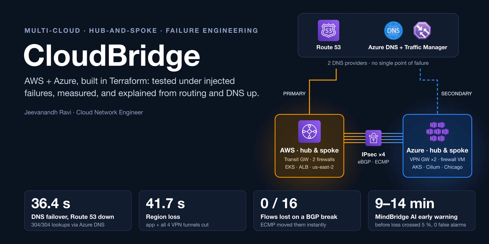
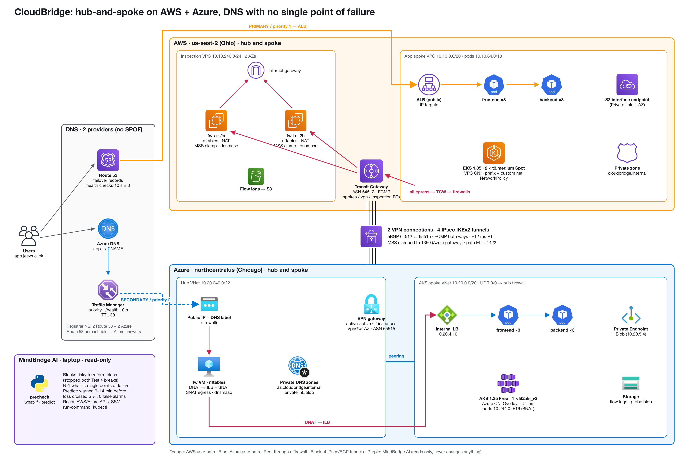
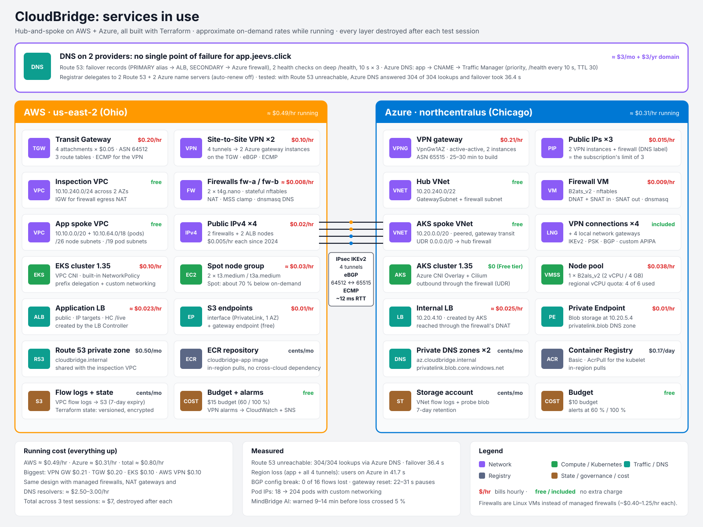

# CloudBridge



[](https://github.com/Jeevanandh32/CloudBridge/actions/workflows/ci.yml)

▶ **[Watch the 2-minute walkthrough](docs/cloudbridge-demo.mp4)** (with music) · [portfolio](https://jeevanandh32.github.io/#cloudbridge)

A multi-cloud, active-passive network across AWS and Azure, built with Terraform, then tested with
injected failures, measured, and explained from the routing and DNS layer up:
- **Hub-and-spoke on both clouds:** a Transit Gateway with inspection firewalls on AWS, and a hub
  VNet with a firewall VM and a peered AKS spoke on Azure.
- **Private link:** a 4-tunnel active-active IPsec/eBGP VPN between the two hubs.
- **Kubernetes:** EKS (active) and AKS (passive), with their pod networking tested across the VPN.
- **DNS on two providers:** Route 53 and Azure DNS with Traffic Manager, so DNS has no single point
  of failure.
- **MindBridge AI:** a read-only tool that checks every change before it is applied and warns
  before failures that build up gradually.

> **Status (2026-11-23):** complete. All 6 tests ran across 3 sessions, and every layer
> was destroyed afterwards. The plan is in [`docs/plan.md`](docs/plan.md). v1
> (2 tunnels, Route 53 only, 14 tests) is at tag
> [`v1`](https://github.com/Jeevanandh32/CloudBridge/tree/v1), with its tests and raw data in
> [`docs/archive/v1/`](docs/archive/v1/) and [`tests/archive/v1/`](tests/archive/v1/).

## Results




Six network tests across 3 sessions, about $7 of cloud time in total. Every number is measured;
raw data and the full write-ups are in [`docs/runs/`](docs/runs/).

| Test | What was broken | Result |
|---|---|---|
| [1. DNS with no single point of failure](docs/runs/test1-summary.md) | Every Route 53 name server made unreachable, then the AWS app taken down | **304/304 lookups answered by Azure DNS**; failover to Azure in **36.4 s** with Route 53 gone; failback in 14.5 s with 0 errors |
| [2. Region loss](docs/runs/test2-summary.md) | AWS app scaled to 0 **and** all 4 VPN tunnels cut | Users on Azure in **41.7 s** (v1: ~102 s); BGP withdrew routes in both clouds in 53 s |
| [3. Hybrid routing](docs/runs/test3-summary.md) | BGP config break on 1 tunnel; an Azure gateway instance reset | Config break: **0 of 16 flows lost a packet**. Instance reset: 38 % of flows paused 22–31 s, never a full outage; redundancy back after 14 min |
| [4. Hub-and-spoke firewall](docs/runs/test4-summary.md) | A missing TGW route; TGW appliance mode toggled | The route mistake blackholed all traffic while everything looked healthy, and **MindBridge AI blocked the change in advance**. Re-enabling appliance mode caused ~14 min of asymmetric drops |
| [5. Pod networking](docs/runs/test5-summary.md) | Pod IP exhaustion, then cross-cloud pod reachability | The ENI limit and then **/28 fragmentation stalled a node rollout** with IPs still free; custom networking took pods **18 → 204**. Routable vs overlay pod IPs and their SNAT behaviour proven with tcpdump |
| [6. Kubernetes traffic control](docs/runs/test6-summary.md) | Default-deny NetworkPolicy; egress lockdown; inbound DNAT | Policy **14/14**; the Azure FQDN allowlist blocked Docker Hub on 443; AWS port rules **still let any site out on 443**; the inbound path was fixed with SNAT |

**MindBridge AI** ([`tools/mindbridge/`](tools/mindbridge/)) checks every `terraform plan`
before it is applied, runs a what-if sweep of single-component failures, and watches warning
signs. Every prediction was compared with the measurement, and the model was corrected from the
data. Most of its first guesses were wrong in useful ways:
- It treated a clean BGP failure like a silent one.
- It didn't model the 14-minute reduced-redundancy window.
- It assumed appliance mode matters for VPN traffic.
- It watched free IPs instead of free /28 blocks.
- Its first loss probe was too coarse to see a slow ramp.

Calibration tables: [`tools/mindbridge/README.md`](tools/mindbridge/README.md).

**Early warning, measured live:** a packet-loss ramp was injected on the cross-cloud path, and
MindBridge AI warned **9–14 minutes before loss crossed 5 %, with 0 false alarms**
([write-up](docs/runs/slowburn2-summary.md)). In Session 1, with a coarser probe, the same ramp
went unpredicted.

## Architecture

- **North-south (users):** `app.jeevs.click` is delegated to **2 Route 53 + 2 Azure DNS** name
  servers, and both providers answer:
  - **Route 53:** failover records with health checks.
  - **Azure DNS:** a CNAME to a **Traffic Manager** priority profile.
  - **Where users land:** the AWS ALB while its deep `/health` check passes; otherwise the Azure
    firewall's public IP, which DNATs to the AKS internal load balancer. If either DNS provider is
    unreachable, resolvers use the other one.
- **AWS hub and spoke:** the app spoke VPC sends all egress (internet and Azure) to the **Transit
  Gateway**. The Transit Gateway passes it through the **inspection VPC**: 2 Linux firewalls,
  1 per AZ, running stateful nftables with NAT, an MSS clamp and DNS forwarding. Users enter
  through the ALB in the spoke.
- **Azure hub and spoke:** the AKS spoke is peered to the hub with gateway transit, and a
  `0.0.0.0/0` UDR forces all traffic through the hub firewall VM. AKS has no public IP of its own:
  the student quota of 3 is used by the 2 VPN gateway instances and the firewall.
- **East-west (private):** **2 AWS VPN connections × 2 tunnels** go to an **active-active** Azure
  VPN gateway, with eBGP 64512 ↔ 65515 and ECMP in both directions.
  - **Pod addressing:** EKS pods have routable VPC IPs, and with custom networking they get their
    own /19s. AKS pods use an overlay range and are SNATed to the node IP.
  - **Private DNS:** each side's firewall forwards DNS for the other side's private zones.
- **Separate failure domains:** user failover never depends on the VPN. Test 2 cut the app and all
  4 tunnels together, and users were on Azure in 41.7 s.

## Design decisions

| Decision | Why |
|---|---|
| **Active-passive, with Azure always running** | Failover must not need instance launches or control-plane calls. Azure took over in every test with nothing to start. |
| **DNS on two providers** (Route 53 + Azure DNS / Traffic Manager) | Removes DNS as a single point of failure. Measured: with Route 53 unreachable, 304/304 lookups answered and failover in 36.4 s. |
| **Linux VMs as firewalls** instead of AWS Network Firewall / Azure Firewall | About $0.01/hr per firewall instead of about $0.40–1.25/hr, and the routing design is the same. Production upgrade point: above about 1 Gbps or for managed IDS. |
| **Transit Gateway with only the attachments the tests need** | Each attachment costs $0.05/hr, so 4 attachments, not one per hypothetical spoke. |
| **Active-active Azure VPN gateway, 4 tunnels, ECMP** | Losing one instance costs half the tunnels, not the link. Measured: 22–31 s pause on 38 % of flows, never a full outage. |
| **Appliance mode set at build time and left alone** | Toggling it on live traffic caused about 14 min of asymmetric drops (Test 4). |
| **Inbound DNAT plus SNAT on the Azure firewall** | The AKS node NSG only admits VNet sources, and the internal LB rewrites the destination. SNAT makes the flow symmetric through one stateful device, which is how Azure Firewall DNAT works too. |
| **EKS custom networking with secondary-CIDR pod subnets** | Prefix delegation in /26 node subnets failed from /28 fragmentation while IPs were still free. Custom networking took pods from 18 to 204. |
| **AKS Azure CNI Overlay + Cilium, outbound through the firewall** | Saves VNet IPs and gives NetworkPolicy. It also shows the overlay vs routable pod model across the VPN. |
| **Spot nodes, Free AKS tier, smallest viable sizes** | About $0.80/hr with everything up, and each session was destroyed afterwards. |
| **MindBridge AI is read-only, and checks plans before apply** | It warns and blocks, and a human applies every fix. Its models were corrected from every measured test. |
| **Layered Terraform with remote state** | Each layer reads others only through `terraform_remote_state` outputs, so there are no hand-copied IDs. Each test applies only the layers it needs. |
| **AWS in us-east-2; Azure in northcentralus** | This avoids us-east-1. The Azure for Students policy allows only 5 regions, and northcentralus is the closest to Ohio. |

## Services and cost



Generated by [`docs/services_dashboard.py`](docs/services_dashboard.py). All the tests together cost about $7.

## Tech stack

| Area | Tools |
|---|---|
| Infrastructure as code | Terraform ≥ 1.17 (aws ~> 6.0, azurerm ~> 4.0), registry module `eks`, S3 backend with native locking |
| AWS networking | Transit Gateway (3 route tables, ECMP), inspection VPC, Site-to-Site VPN ×2, ALB, S3 gateway + interface endpoints, Route 53 (public + private), VPC Flow Logs |
| Azure networking | Hub-and-spoke VNets with peering, active-active VPN Gateway (VpnGw1AZ), UDRs, internal Standard LB, Private Endpoint, Private DNS, Azure DNS, Traffic Manager, VNet flow logs |
| Firewalls | Ubuntu 24.04 with nftables (stateful filtering, NAT/DNAT/SNAT, MSS clamp) and dnsmasq (hybrid DNS forwarding, nftset FQDN allowlists) |
| Routing | IPsec IKEv2, eBGP (64512 ↔ 65515), ECMP |
| Kubernetes | EKS 1.35 (VPC CNI with NetworkPolicy, prefix delegation, custom networking; Spot node group; Pod Identity) · AKS 1.35 (Azure CNI Overlay + Cilium) · Kustomize · Helm (AWS Load Balancer Controller) |
| App | Python FastAPI + httpx, Docker (linux/amd64), ECR, ACR |
| Observability | CloudWatch alarms + SNS, Azure Monitor alerts, Route 53 and Traffic Manager health checks, flow logs |
| MindBridge AI | Python (stdlib + PyYAML + python-hcl2), SQLite signal store, the Anthropic API for optional explanations |
| Testing | Bash + Python, unbound, iperf3, tcpdump, conntrack, tc netem, netshoot |
| CI | GitHub Actions on every push: `terraform fmt` + `validate` on all 10 layers, 118 MindBridge AI tests, a change gate that must block a known-bad plan, Kustomize renders, script syntax |

## Repository layout

| Path | What it is |
|---|---|
| `terraform/bootstrap/` | S3 state bucket (local state, apply once) |
| `terraform/aws/hub/` | Transit Gateway + 3 route tables, inspection VPC, firewalls fw-a/fw-b, flow logs |
| `terraform/aws/spoke-app/` | App VPC, TGW attachment, ALB subnets, S3 endpoints, private zone, optional secondary CIDR and test hosts |
| `terraform/aws/eks/` | EKS, Spot node group, VPC CNI (NetworkPolicy, prefix delegation, custom networking), CoreDNS forwarding, ECR, LB Controller role |
| `terraform/azure/hub/` | Resource group, hub VNet, **active-active VPN gateway (about 25 min to build)**, firewall VM, private DNS zones, storage, flow logs |
| `terraform/azure/spoke-aks/` | AKS spoke VNet, peering, UDRs, Private Endpoint, flow logs |
| `terraform/azure/aks/` | AKS (Overlay + Cilium, outbound through the firewall), ACR, identities |
| `terraform/connectivity/vpn/` | 2 customer gateways, 2 VPN connections on the TGW, 4 local network gateways + connections, BGP, VPN alarms |
| `terraform/global/dns/` | Route 53 failover + health checks, Azure DNS zone + Traffic Manager, apex NS on both, registrar delegation |
| `terraform/ops/` | Budgets in both clouds |
| `app/` | FastAPI app: one image, `ROLE=frontend` or `backend` |
| `k8s/` | Kustomize overlays (`aws`, `azure`), NetworkPolicies, ENIConfigs, CoreDNS config, `deploy.sh` |
| `tests/` | One script per test, plus `inventory.sh` (`tests/archive/v1/` has the v1 scripts) |
| `tools/mindbridge/` | MindBridge AI: precheck, what-if, watch/predict/replay, explain (118 tests) |
| `docs/` | Plan, runbooks, results (`runs/`), diagrams as code (`architecture.py`, `cover.py`, `services_dashboard.py`), v1 archive (`archive/v1/`) |

## Rebuild it

The step-by-step runbooks cover the checks for each layer:
- [Session 1](docs/session1-runbook.md): networks, firewalls, VPN; Tests 3–4.
- [Session 2](docs/session2-runbook.md): clusters; Tests 5–6.
- [Session 3](docs/session3-runbook.md): DNS; Tests 1–2.

Alarm procedures are in [`docs/runbook.md`](docs/runbook.md).

### Prerequisites
- **Tools:** Terraform ≥ 1.17, AWS CLI, Azure CLI, kubectl, Helm, Docker, jq.
- **AWS:** `aws configure`, as an IAM user with MFA, region `us-east-2`.
- **Azure:** `az login`, then `export ARM_SUBSCRIPTION_ID=$(az account show --query id -o tsv)`.
- **Domain:** a domain registered in Route 53 Domains, with its hosted zone already created
  (default `jeevs.click`).
- **Git-ignored config:**
  - `terraform/backend.hcl`;
  - `alert_email` in `connectivity/vpn` and `ops`;
  - `admin_cidrs = ["<your-ip>/32"]` in `aws/eks` and `azure/aks`.

### Order
Run each layer with `terraform init -backend-config=../../backend.hcl`, then `terraform plan -out=layer.tfplan`, then `caffeinate -i terraform apply layer.tfplan`. For `ops`, use `../backend.hcl`.
```
azure/hub (start first, ~25 min) ─┐
aws/hub → aws/spoke-app → aws/eks │
                                  └→ azure/spoke-aks → connectivity/vpn → azure/aks → ops
then: LB Controller (Helm) → k8s/deploy.sh → global/dns
```
CI runs the same checks offline on every push ([`.github/workflows/ci.yml`](.github/workflows/ci.yml)), so a change that fails validation or would blackhole traffic is caught before anything is applied.

Before any apply during a test session, run MindBridge AI's pre-change check on the plan:
```bash
terraform show -json layer.tfplan > /tmp/plan.json && (cd tools && python -m mindbridge precheck /tmp/plan.json)
```

### Verify
```bash
tests/test3-hybrid-routing.sh check     # tunnels, BGP, ping/HTTP across the VPN, DNS both ways
tests/test1-dns-no-spof.sh check        # both DNS providers answer app.jeevs.click
curl -s http://app.jeevs.click/health   # {"status":"ok","cloud":"aws"}
```

## Run the tests

| Test | Command | What it breaks |
|---|---|---|
| 1. DNS, no single point of failure | `tests/test1-dns-no-spof.sh provider-loss`, then `failover-without-route53` | Drops every Route 53 name server on a test resolver, then scales the AWS app to 0 |
| 2. Region loss | `tests/test2-region-loss.sh break`, then `restore` | AWS app to 0 + wrong PSKs on all 4 connections (restore is the Terraform drift fix) |
| 3. Hybrid routing | `tests/test3-hybrid-routing.sh paths`, `bgp-break`, `instance-down`, `mtu` | Wrong peer ASN on one tunnel; reset of one Azure gateway instance |
| 4. Hub firewall | `tests/test4-hub-firewall.sh baseline`, `break-a`, `break-b` | Removes the spoke's TGW propagation; toggles appliance mode |
| 5. Pod networking | `tests/test5-pod-networking.sh capacity`, `prefix`, `custom`, `xcloud`, `private` | Scales pods to the IP limits; switches IP modes; cross-cloud pod reachability |
| 6. Traffic control | `tests/test6-traffic-control.sh policy`, `egress-azure`, `egress-aws`, `inbound-asym` | Default-deny NetworkPolicy; egress lockdown on the firewalls |

Every script restores what it broke on exit, or prints the exact Terraform command that does.
MindBridge AI:
```bash
cd tools
python -m mindbridge whatif                      # single-component failure sweep -> docs/mindbridge/whatif-report.md
python -m mindbridge watch --interval 60         # read-only collectors -> local SQLite
python -m mindbridge predict --since 30m         # early warnings with impact
python -m mindbridge replay <series.csv>         # score lead time and false alarms
```

## Tear down

```bash
cd terraform/global/dns && terraform destroy          # first: it reads the ALB
~/cloudbridge-restore-ns.sh                            # put the 4 Route 53 name servers back (saved after the DNS apply)
kubectl --context cloudbridge-eks -n cloudbridge delete ingress frontend   # the controller deletes the ALB
kubectl --context cloudbridge-aks -n cloudbridge delete svc frontend       # AKS deletes the internal LB
# then: aws/eks + azure/aks -> connectivity/vpn -> azure/spoke-aks + aws/spoke-app -> aws/hub + azure/hub
tests/inventory.sh                                     # must end with CLEAN
```
Keep `bootstrap` (the state bucket costs cents) and `ops` (the budgets are free).

**If an Azure destroy fails:** `AnotherOperationInProgress` (409) is Azure allowing only one
operation at a time on a VNet. Re-run the destroy with `-parallelism=1`, and destroy the spoke
before the hub.

## Known limitations and next steps

- **The Azure firewall is a single VM.** Its failure stops Azure ingress, AKS egress and Azure-side
  DNS. A second VM behind an internal LB needs a 4th public IP, which the student quota doesn't
  allow. MindBridge AI ranks this as risk #1.
- **AWS firewalls are pinned per AZ.** The TGW subnet routes point at one firewall's network
  interface, so losing fw-a degrades the AZ-a half until someone fixes it by hand. The production
  answer is Gateway Load Balancer or AWS Network Firewall.
- **The ALB's own name is served by Route 53.** In a total Route 53 outage, a healthy AWS side
  still can't be resolved, so Azure DNS effectively sends everyone to Azure.
- **The textbook appliance-mode failure wasn't reproduced.** It needs VPC-to-VPC traffic across
  AZs, which means a second spoke VPC, about +$0.05/hr.
- **Single AKS node.** This is set by the regional vCPU quota.
- **Small samples.** Most tests ran once or twice in a lab, and MindBridge AI's thresholds were
  calibrated on those runs.
- **Unexplained, to follow up:**
  - AWS → Azure TCP MSS arrived at 1170, lower than expected.
  - Cilium's drop monitor caught no events, although the policy blocks worked.

## v1 (archived)

v1 had 2 tunnels on a VGW, a single VNet, Route 53 as the only DNS provider, and 14 tests,
including node failure and ALB errors. Its code is at tag
[`v1`](https://github.com/Jeevanandh32/CloudBridge/tree/v1). Its results:
[`docs/archive/v1/results.md`](docs/archive/v1/results.md), raw runs in
[`docs/archive/v1/runs/`](docs/archive/v1/runs/), runbook in
[`docs/archive/v1/runbook.md`](docs/archive/v1/runbook.md), IP plan in
[`docs/archive/v1/ip-plan.md`](docs/archive/v1/ip-plan.md).

### v1 key findings

| Failure injected | What I measured | What I learned |
|---|---|---|
| **The backend's DNS record** (inspired by the Oct 2025 AWS outage) | Sampled health-status upper bounds 32–69 s; clients on Azure 62–145 s; tuned failback **68–78 s** | DNS negative caching delayed recovery. Lowering the private-zone SOA TTL/minimum from the initial settings improved the recorded failback times. |
| **The whole AWS app** | Clients on Azure 77–107 s, back in 77–93 s, **0 failed requests on failback** | Detection is fast; the tail is **resolver caching** of the ALB alias's fixed 60 s TTL. |
| **Simulated AWS app + VPN loss** (app scaled to zero; both tunnel PSKs invalidated) | Client reached Azure at +102 s; BGP withdrew routes in both clouds; alarms fired and cleared | Public application failover and the private VPN were exercised as separate failure paths. |
| **An EKS worker node** | User-facing errors **89 s → 57 s (−36%)** with tuned ALB/K8s timers | Kubernetes recovered in 9–30 s; **the load balancer was the bottleneck**. |
| **BGP on the active tunnel** (IPsec up) | **0.8 s longest ping-reply gap; 9 unanswered probes** at 5 probes/s | The test observed a short traffic interruption during path change. This is not a measurement of BGP detection or tunnel-rebuild time. |
| **MTU / route propagation / NACL / ALB / pod IPs** | Path MTU 1422, MSS clamped 1310/1360 · green dashboard + blackholed traffic · one-way NACL failure · 502/503/504 decoded · 17 pods per t3.medium | Break/fix lab: each fault hides behind a healthy-looking layer. |

Every run, number, and raw CSV: [`docs/archive/v1/results.md`](docs/archive/v1/results.md) and [`docs/archive/v1/runs/`](docs/archive/v1/runs/).
Alarms and recovery procedures: [`docs/archive/v1/runbook.md`](docs/archive/v1/runbook.md).

#### v1 measurement boundaries

- These are controlled lab measurements. HTTP failover is timed from fault injection to the first successful response from the standby, using approximately one request per second.
- The **77–107 s** application-failover range comes from three app-loss runs. DNS-dependency failures took **62–145 s**; the results do not establish a universal under-two-minute recovery guarantee.
- The BGP experiment reports the largest observed ping-reply gap, not elapsed time from the configuration request to BGP failure detection. Nine probes were unanswered across that run.
- MTU tests measured **1422 bytes AWS → Azure** and **1420 bytes Azure → AWS**. Packet captures observed gateway MSS clamping to **1310/1360**; this project did not configure a manual MSS adjustment.
- The regional-loss scenarios disable the application and, in Test 5, its private VPN. They do not reproduce every failure mode of an actual cloud-provider regional outage.
- The node-failure comparison uses one completed default run and two tuned runs: the mean last-error time fell from **88.7 s to 56.8 s**. The **36%** figure refers to this recovery-time measure; failed-request counts fell from 26 to 18 (**31%**).
