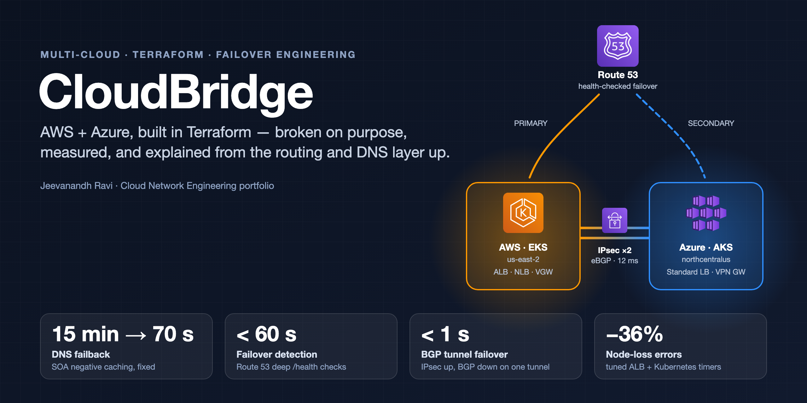
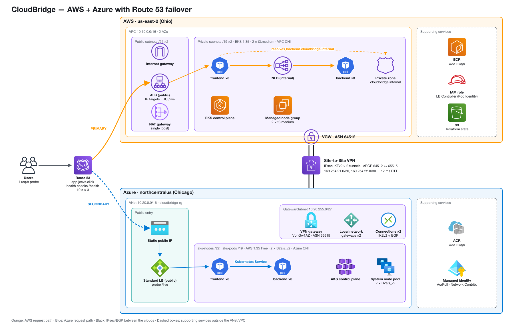
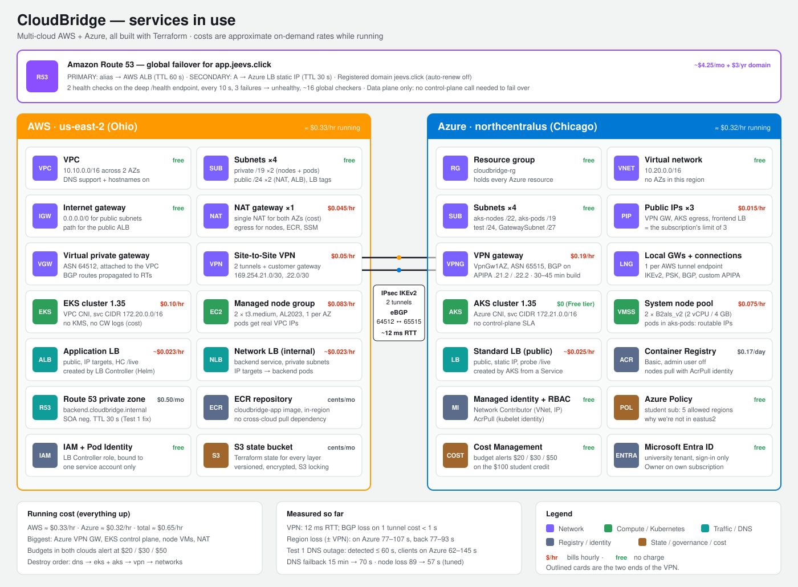

# CloudBridge



▶ **[Watch the 2-minute walkthrough](docs/cloudbridge-demo.mp4)** (with music), also on my [portfolio](https://jeevanandh32.github.io/#work).

Multi-cloud AWS + Azure platform built with Terraform — then broken on purpose, measured, and
explained from the routing and DNS layer up. Warm standby: EKS (AWS) primary, AKS (Azure) secondary,
Route 53 health-checked failover, and a separate IPsec/eBGP VPN between the private networks.

> **Status (2026-10-18):** all tests complete; every cloud layer has been destroyed to stop costs.
> The code rebuilds everything (~70 min, the Azure VPN gateway is the slow part) — see [Rebuild it](#rebuild-it).

## Architecture



- **North-south (users):** `app.jeevs.click` resolves through **Route 53**, which answers with the AWS ALB
  (PRIMARY) while its deep `/health` check passes, otherwise with the Azure Standard LB (SECONDARY).
- **East-west (private):** two **IPsec IKEv2 tunnels with eBGP** (AWS ASN 64512 ↔ Azure 65515) join
  `10.10.0.0/16` and `10.20.0.0/16`; pods in both clouds have routable IPs (VPC CNI / Azure CNI).
- **Separate failure domains:** failover never uses the VPN, so losing a whole region — tunnels
  included — doesn't block it (measured in Test 5).

## Key findings

| What I broke | What I measured | What I learned |
|---|---|---|
| **The backend's DNS record** (repro of the Oct 2025 AWS outage) | Detected ≤ 60 s; clients on Azure 62–145 s; failback **> 3 min → ~70 s** after tuning | **DNS negative caching** (SOA minimum, RFC 2308) made recovery up to 15 min — 10× slower than the outage. Fixed with one SOA record. |
| **The whole AWS app** | Clients on Azure 77–107 s, back in 77–93 s, **0 failed requests on failback** | Detection is fast; the tail is **resolver caching** of the ALB alias's fixed 60 s TTL. |
| **The whole AWS region incl. both VPN tunnels** | Failover unchanged (+102 s); BGP withdrew routes in both clouds; alarms fired and cleared | Failover never depends on the VPN — **separate failure domains**. |
| **An EKS worker node** | User-facing errors **89 s → 57 s (−36%)** with tuned ALB/K8s timers | Kubernetes recovered in 9–30 s; **the load balancer was the bottleneck**. |
| **BGP on the active tunnel** (IPsec up) | **< 1 s** of loss (traffic moved to the other tunnel) | AWS shows the tunnel DOWN when only BGP is down; Azure shows it Connected. |
| **MTU / route propagation / NACL / ALB / pod IPs** | Path MTU 1422, MSS clamped 1310/1360 · green dashboard + blackholed traffic · one-way NACL failure · 502/503/504 decoded · 17 pods per t3.medium | Break/fix lab: each fault hides behind a healthy-looking layer. |

Every run, number, and raw CSV: [`docs/results.md`](docs/results.md) and [`docs/runs/`](docs/runs/).
Alarms and recovery procedures: [`docs/runbook.md`](docs/runbook.md).

## Design decisions

| Decision | Why |
|---|---|
| **Warm standby** in Azure (always running) | Lesson from Oct 2025: failover must not need launches or control-plane calls. Azure took over in every test with nothing to start. |
| **Deep `/health` for Route 53 and readiness; shallow `/live` for liveness and LB checks** | A broken dependency should move traffic, not restart healthy frontends. |
| **Route 53 data plane only** for failover | Health checks and DNS answers are global; record edits (control plane) live in us-east-1. |
| **One image registry per cloud** (ECR, ACR) | No cross-cloud pull dependency during an incident. |
| **BGP over two tunnels** instead of static routes | Automatic withdrawal and reroute — measured < 1 s when one tunnel's BGP failed. |
| **AWS in us-east-2**, not us-east-1 | Avoid the region (and hidden dependencies) that failed in Oct 2025. |
| **Azure in northcentralus**, VpnGw1AZ | The Azure for Students policy allows only 5 regions; non-AZ VPN SKUs can no longer be created, AZ SKUs run regional in a no-zone region. |
| **Smallest viable sizes**, single NAT, Free AKS tier | Cost: ≈ $0.65/hr with everything up; budgets alert at $20 / $30 / $50 in both clouds. |
| **Layered Terraform with remote state** | Each layer reads others only through `terraform_remote_state` outputs; no hand-copied IDs. |

## Services and cost



## Tech stack

| Area | Tools |
|---|---|
| Infrastructure as code | Terraform ≥ 1.10 (aws ~> 6.0, azurerm ~> 4.0), registry modules `vpc` / `eks` / `eks-pod-identity`, S3 backend with native locking |
| Networking | AWS VPC, NAT, VGW, Site-to-Site VPN · Azure VNet, VPN Gateway, local network gateways · IPsec IKEv2, eBGP, Route 53 (public + private zones) |
| Kubernetes | EKS 1.35 (VPC CNI, managed node group, Pod Identity) · AKS 1.35 (Azure CNI pod subnet) · Kustomize · Helm (AWS Load Balancer Controller) |
| Load balancing | ALB (IP targets), internal NLB, Azure Standard LB |
| App | Python FastAPI + httpx, Docker (linux/amd64), ECR, ACR |
| Observability | CloudWatch alarms + SNS, Azure Monitor metric alerts, Route 53 health checks, VPC Reachability Analyzer |
| Testing | Bash + Python probes and analysers, netshoot (ping, iperf3, tcpdump, tracepath) |

## Repository layout

| Path | What it is |
|---|---|
| `terraform/bootstrap/` | S3 state bucket (local state, apply once) |
| `terraform/azure/network/` | Resource group, VNet, 4 subnets, **VPN gateway (30–45 min to build)** → `azure/network.tfstate` |
| `terraform/aws/network/` | VPC, subnets, single NAT, VGW with route propagation → `aws/network.tfstate` |
| `terraform/connectivity/vpn/` | Customer gateway, VPN (2 tunnels), Azure local gateways + connections, BGP, **VPN alarms** → `connectivity/vpn.tfstate` |
| `terraform/aws/eks/` | EKS, node group, ECR, LB Controller IAM (Pod Identity), private zone `cloudbridge.internal` → `aws/eks.tfstate` |
| `terraform/azure/aks/` | AKS, ACR, static frontend IP, role assignments → `azure/aks.tfstate` |
| `terraform/global/dns/` | Route 53 health checks + PRIMARY/SECONDARY failover records → `global/dns.tfstate` |
| `app/` | FastAPI app: one image, `ROLE=frontend` or `backend`; fault endpoints only with `ENABLE_FAULTS=true` |
| `k8s/` | Kustomize base + overlays `aws`, `aws-tuned`, `azure`; `deploy.sh` fills in the registry from Terraform outputs |
| `tests/` | Probe, analysers, and one script per test (see [Run the tests](#run-the-tests)) |
| `docs/` | IP plan, results, runbook, diagrams (`architecture.py` is diagrams-as-code), raw run data |

Each Terraform layer is a single `main.tf` grouped by component (variables, resources, and outputs
together). Layers find the state bucket by name (`cloudbridge-tfstate-<aws-account-id>`).
All address ranges and ASNs: [`docs/ip-plan.md`](docs/ip-plan.md).

## Rebuild it

### Prerequisites
- Terraform ≥ 1.10, AWS CLI, Azure CLI, kubectl, Helm, Docker
- `aws configure` (IAM user with MFA, region `us-east-2`)
- `az login`, then `export ARM_SUBSCRIPTION_ID=$(az account show --query id -o tsv)`
- A Route 53 domain (set `domain` in `terraform/global/dns`; default `jeevs.click`)
- Budget alerts in both clouds

### 1. State bucket
```bash
cd terraform/bootstrap && terraform init && terraform apply
cp ../backend.hcl.example ../backend.hcl                        # put your AWS account ID in the bucket name
cp ../connectivity/vpn/terraform.tfvars.example ../connectivity/vpn/terraform.tfvars   # alarm email
```

### 2. Infrastructure layers
Same pattern for every layer (`caffeinate -i` keeps a Mac awake — if it sleeps, the state upload fails):
```bash
cd terraform/<layer>
terraform init -backend-config=../../backend.hcl
terraform plan -out=layer.tfplan
caffeinate -i terraform apply layer.tfplan
```
Order: `azure/network` (start first) → `aws/network` → `connectivity/vpn` → `aws/eks` + `azure/aks`.

### 3. App
```bash
# image, pushed to both registries (registry names from Terraform outputs)
docker build --platform linux/amd64 -t cloudbridge-app:v1 app/
ECR=$(terraform -chdir=terraform/aws/eks output -raw ecr_repository_url)
ACR=$(terraform -chdir=terraform/azure/aks output -raw acr_login_server)
aws ecr get-login-password | docker login --username AWS --password-stdin ${ECR%%/*}
az acr login -n ${ACR%%.*}
docker tag cloudbridge-app:v1 $ECR:v1 && docker push $ECR:v1
docker tag cloudbridge-app:v1 $ACR/cloudbridge-app:v1 && docker push $ACR/cloudbridge-app:v1

# kubeconfig, LB Controller, app
aws eks update-kubeconfig --region us-east-2 --name cloudbridge-eks --alias cloudbridge-eks
az aks get-credentials -g cloudbridge-rg -n cloudbridge-aks
helm repo add eks https://aws.github.io/eks-charts
helm upgrade --install aws-load-balancer-controller eks/aws-load-balancer-controller --version 3.6.0 \
  -n kube-system --kube-context cloudbridge-eks --set clusterName=cloudbridge-eks \
  --set serviceAccount.create=true --set serviceAccount.name=aws-load-balancer-controller \
  --set region=us-east-2 --set vpcId=$(terraform -chdir=terraform/aws/eks output -raw vpc_id)
k8s/deploy.sh aws && k8s/deploy.sh azure
tests/backend-dns.sh set          # backend.cloudbridge.internal -> internal NLB
```

### 4. Global DNS
Apply `terraform/global/dns` (it finds the ALB by its controller tags and the Azure IP from AKS state).

### Verify
```bash
curl -s http://app.jeevs.click/                       # "cloud":"aws"
aws ec2 describe-vpn-connections --query "VpnConnections[].VgwTelemetry[].[OutsideIpAddress,Status]" --output table
az network vnet-gateway list-bgp-peer-status -g cloudbridge-rg -n cloudbridge-vpngw -o table
```

## Run the tests

| Test | Command | What it breaks |
|---|---|---|
| 1. DNS outage | `tests/test1-dns-outage.sh <run>` | Deletes `backend.cloudbridge.internal` |
| 2. Region loss | `tests/test2-region-loss.sh <run>` | Scales the AWS app to 0 |
| 3. Node failure | `tests/test3-node-failure.sh default-1` (then `k8s/deploy.sh aws-tuned`, `... tuned-1`) | Terminates an EKS worker |
| 4. B1 BGP down | `tests/test4-b1-bgp-down.sh` | Wrong peer ASN on the active tunnel |
| 4. B2 MTU/MSS | `tests/test4-b2-mtu.sh` | Measurement only |
| 4. B3 Route propagation | `tests/test4-b3-route-propagation.sh` | Disables VGW route propagation |
| 4. B4 NACL | `tests/test4-b4-nacl.sh` | Denies ephemeral ports from Azure |
| 4. B5 ALB errors | `tests/test4-b5-lb-errors.sh` | Fault endpoints + 5 s idle timeout |
| 4. B6 Pod IPs | `tests/test4-b6-pod-ips.sh` | Scales the backend to 30 |
| 5. C2 Region + VPN | `tests/test5-c2-region-vpn.sh break`, then `terraform apply` in `connectivity/vpn`, then `... restore` | App to 0 + wrong PSKs |

Every script restores what it broke on exit (C2's restore is the Terraform drift fix, by design).

## Tear down

Destroy in reverse, and remove controller-created load balancers **before** the clusters:
```bash
cd terraform/global/dns && terraform destroy                     # first: it looks up the ALB
kubectl --context cloudbridge-eks delete namespace cloudbridge   # controller deletes ALB + NLB
kubectl --context cloudbridge-aks delete namespace cloudbridge   # AKS removes its LB rule
helm --kube-context cloudbridge-eks uninstall aws-load-balancer-controller -n kube-system
# then: aws/eks + azure/aks -> connectivity/vpn -> aws/network + azure/network
# keep bootstrap (the state bucket costs cents)
```

## Known limitations and next steps

- **Client-side failover tail (~1–2 min):** bounded by resolver caching of the ALB alias's 60 s TTL;
  anycast (AWS Global Accelerator) would remove it.
- **Node-failure tail (~55 s, tuned):** longer than the ALB timers explain — next: pod readiness
  gates and ALB access logs.
- **NACL partial enforcement (B4):** about half of new connections passed an ephemeral-port deny;
  next: VPC Flow Logs.
- **Not yet tested:** a NotReady-but-present node (kubelet stop, where the 300 s → 30 s toleration
  matters), failures on the Azure side, and a full rebuild from scratch with the final code.
- **Single NAT gateway and active-standby Azure VPN gateway** are cost choices, not HA choices.
